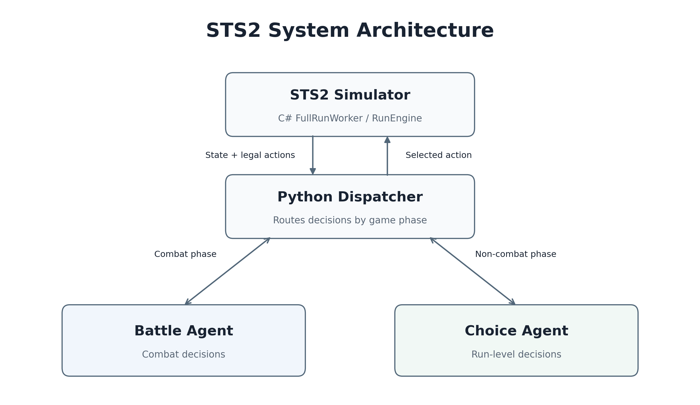

# STS2 RL Research

Reinforcement learning research for Slay the Spire 2, with a reproducible
two-agent benchmark and experimental card, state, and action representations.

| Start here | Status | Contents |
| --- | --- | --- |
| [Two-agent benchmark](docs/RUNNING.md) | Released · v1.0.0 | Selected models, evaluation instructions, and recorded evidence |
| [Semantic card encoding](research/semantic_card_v1/README.md) | Experimental · schema v1 | Feature positions and meanings, mechanics catalog, and runnable examples |
| [Current-hand lethality](research/current_hand_lethality_v1/README.md) | Experimental · v1 | Address inconsistent card ordering with explicit kill signals; HP masking, comparisons, and a worked example |
| [Four mechanism features](research/startup_mechanisms_v1/README.md) | Experimental · v1 | Help the Battle agent learn Rupture, Demon Form, Exhaust/Ashen, and Hellraiser interactions through card roles and combat-state features |

## Released benchmark · v1.0.0

**26.6% best observed validation win rate for Ironclad at Ascension 2 across all three acts: 68 victories in 256 simulator runs.**

Two learned agents play together. The **Battle agent** chooses combat actions and targets. The **Choice agent** makes decisions between combats, including route, rewards, shops and events.

The benchmark contains the selected agent pair, its recorded evidence, and the matching simulator runtime. The result below belongs to this released pair. Each research module documents its own scope and available evidence.

## Overview



See [the detailed Battle and Choice architectures](docs/ARCHITECTURE.md).

## Result

| Condition or outcome | Value |
| --- | --- |
| Character / difficulty | Ironclad / Ascension 2 |
| Run length | Three acts |
| Victories | **68 / 256 (26.5625%)** |
| Battle turn limits | 4, counted as nonwins |

See [the result report](docs/RESULTS.md), [per-run outcomes](results/runs.jsonl), [evaluation conditions](results/evaluation_config.json), and [checkpoint identities](results/model_identities.json).

**Reproduction note:** the macOS arm64 replay produced 69/256 wins (26.95%); the headline remains the original 68/256 result. See [verification details](docs/VERIFICATION.md) for the differences and platform limitations.

## What is included

```text
models/       The two selected checkpoint files
runtime/      Frozen Python policy, features and inference dependencies
simulator/    Matching C# emulator/worker source and pinned assemblies
results/      Recorded outcomes, validation seeds, configuration and provenance
scripts/      Artifact verification and evaluation entry points
docs/         Results, execution instructions and verification record
research/     Experimental representations, feature documentation and examples
```

The evaluated release scope is Ironclad only.

## Quick start

### Prerequisites

- Python 3.11+ and pip; locally verified with Python 3.13.15.
- The [.NET 9 runtime](https://dotnet.microsoft.com/en-us/download/dotnet/9.0) for your operating system and processor.
- Git to clone the repository, or download and extract its ZIP.

Evaluation runs on CPU with the included checkpoints and prebuilt simulator. Python dependencies are pinned in [requirements.txt](requirements.txt).

### Install

```sh
git clone https://github.com/shuchi-lab/sts2-rl-research.git
cd sts2-rl-research
python3 -m venv .venv
. .venv/bin/activate
python -m pip install -r requirements.txt
```

On Windows, create the environment with `py -3 -m venv .venv`, then activate it with `.venv\Scripts\activate.bat` in Command Prompt or `.\.venv\Scripts\Activate.ps1` in PowerShell.

### Run

Check the models and isolated Battle runtime, then play one complete Ironclad A2 game using the first retained validation seed:

```sh
python scripts/evaluate.py --check --output-dir runs/check
python scripts/evaluate.py --episodes 1 --output-dir runs/example
```

The game outcome is saved in `runs/example/summary.json`. To replay the full 256-seed validation benchmark:

```sh
python scripts/evaluate.py --all --output-dir runs/validation-256
```

Each evaluation requires a new output directory; choose a different `--output-dir` when repeating a command. See [the running instructions](docs/RUNNING.md) for runtime discovery, output files and evaluation details.

### Check recorded results

To check the recorded evidence with only Python's standard library:

```sh
python scripts/verify_release.py --evidence-only
```

This checks result-file provenance, unique seed coverage and the 68/256 result. [The release verification record](docs/VERIFICATION.md) states what was exercised during packaging.

## Scope and limitations

- The simulator approximates the supported game version. Matching this benchmark is not certification of every game mechanic.
- A battle is limited to 100 turns. Those limit outcomes remain in the win-rate denominator.
- Only the selected model pair is included. Training datasets, replay buffers and cloud launch infrastructure are omitted; research modules publish representation code, examples, and available experiment summaries.
- The original checkpoint bytes and pinned simulator assemblies are retained. Rebuilding source can change assembly identities; follow [the simulator notes](simulator/README.md).
- Checkpoint files are PyTorch artifacts. Load only copies whose hashes match this release.

Original release contributions are available under the [MIT license](LICENSE). See [third-party notices](THIRD_PARTY_NOTICES.md) for upstream attribution and component licenses. Slay the Spire 2 and its associated names belong to their respective owners. This is an independent research project.
