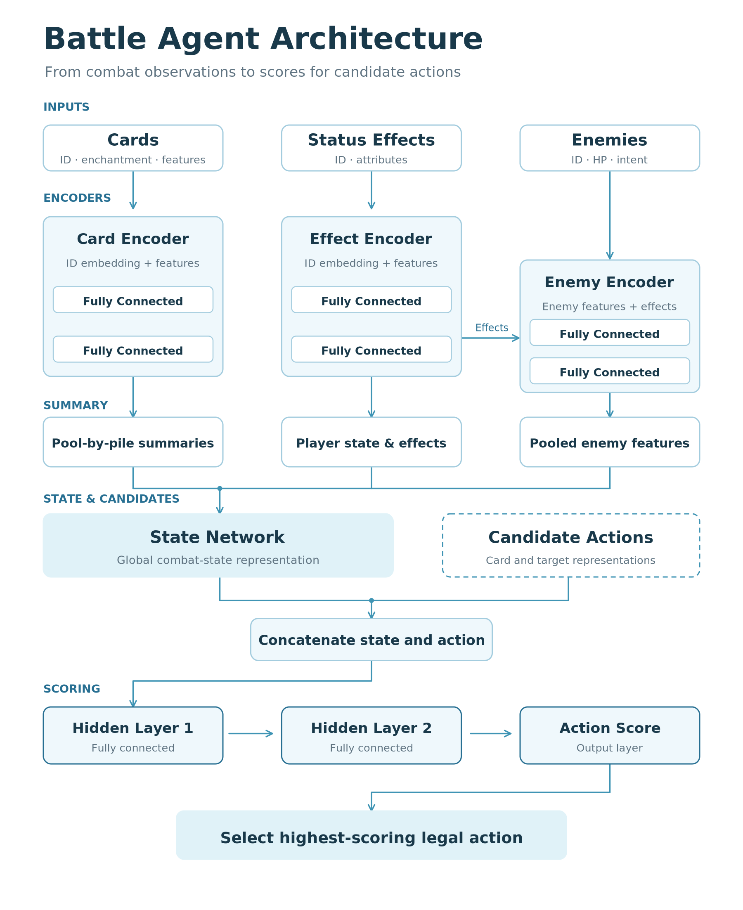
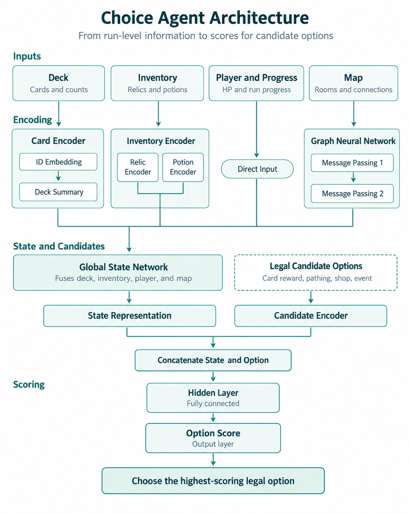

# Released benchmark architecture

These figures describe the released v1.0.0 Battle/Choice pair. The experimental
[semantic card representation](../research/semantic_card_v1/README.md) is a
separate research module and is not the representation used by these checkpoints.

## System

## Battle agent

## Choice agent

See [running instructions](RUNNING.md) and [benchmark evidence](RESULTS.md).
