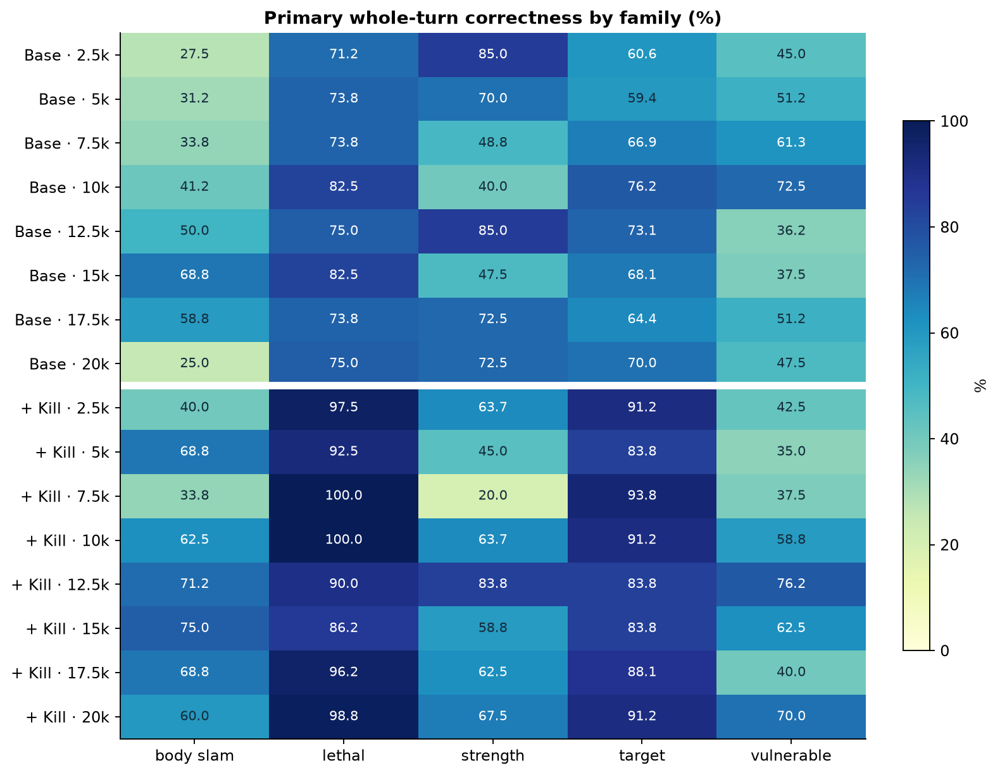
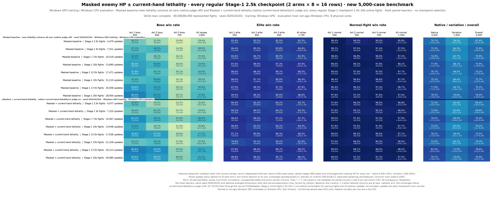

# Current-hand lethality v1

**Experimental research snapshot:** mask enemy maximum HP and HP fraction in the
model's inputs, then add explicit signals about kills reachable with the current
hand. Current enemy HP remains available.

**Motivation:** In this experiment, the baseline struggles to learn reliable card
ordering, motivating explicit killability signals that identify lethal sequences
and useful first actions.

The signals come from a bounded native search, computed at each decision during
training and inference. The policy still chooses its own action.

This folder publishes the field definitions, masking/encoding code, a recorded
native example, and a compact experiment summary. The Python example requires
only NumPy. Computing signals for **new combats** requires the matching native
judge and simulator, which are not included in this module. It does not load or
change the repository's released benchmark models.

| Read next | Contents |
| --- | --- |
| [Feature reference](docs/feature-reference.md) | Every enemy/action position, transforms, masks, and target mapping |
| [Method and limitations](docs/method.md) | Search scope, unknown results, and integration contract |
| [Experiment](docs/experiment.md) | One matched training seed, all eight checkpoint pairs, and limitations |
| [Source record](SOURCE.json) | Original source identities, adaptations, and packaged file hashes |

## What the comparison shows

Both learners mask enemy maximum HP and HP fraction. **Base** receives zero in
the added feature columns; **+ Kill** receives the current-hand lethality signals.
The figures show all eight regular checkpoints per learner, from 2.5k to 20k
stage-one fights. Click either figure to open it at full resolution.

[](figures/behavior-family-comparison.png)

**Figure 1. Card combinations and targets.** At 20k fights, lethal-family
whole-turn correctness increases from **75.0% to 98.8%**, and target-family
correctness from **70.0% to 91.2%**. Improvements vary by family; the added
signals do not solve every ordering problem.

[](figures/battle-win-rate-comparison.png)

**Figure 2. Transfer to complete fights.** At 20k fights, pooled boss win rate
increases from **47.8% to 51.2%**. The feature learner leads on bosses at five of
eight checkpoints, with remaining variation across training. These are individual
combat win rates, not three-act game win rates.

These comparisons use **one matched training seed** and diagnostic evaluation
panels. See the [experiment report](docs/experiment.md) for counts, the full
protocol, and limitations.

## Try the recorded example

From the repository root, using Python 3.11 or later:

```sh
python -m pip install -r research/current_hand_lethality_v1/requirements.txt
python research/current_hand_lethality_v1/examples/inspect_features.py
python research/current_hand_lethality_v1/examples/inspect_features.py --json
python research/current_hand_lethality_v1/examples/inspect_features.py --profile masked_baseline
```

These commands inspect the saved [Bash/Strike fixture](examples/bash_strike.json);
they do not run a new search or a learned policy. The fixture includes the native
judge output and the resulting states of both card orders.

## Why the first card matters

The recorded case has **Bash + Strike, 3 energy, a 15-HP enemy with no block**, and
no damage-modifying buffs at the start. Bash deals 8 damage and applies
Vulnerable; the following Strike deals 9. Reversing the order deals 6 + 8.

| First action | Immediate kill | Kill starting here | Immediate known | Continuation complete |
| --- | ---: | ---: | ---: | ---: |
| Bash → enemy 0 | 0 | 1 | 1 | 1 |
| Strike → enemy 0 | 0 | 0 | 1 | 1 |

The enemy's added vector is `[1, 1]`: a surviving kill sequence was found, and the
search completed. The `end_turn` option has four zero added fields because it is
outside this card-only search. With the baseline profile, all added fields are
zero placeholders, while the two HP-related columns are still masked.

**“No kill found” is not always “cannot kill.”** A result with `found=0` and
`complete=0` is unknown. The method page explains draw/random effects, search
limits, and why killing one enemy does not guarantee winning the combat.

## What changes in the representation

- Enemy dense rows: **30 → 32 fields**. Set positions **1** (`max_hp`) and **2**
  (`hp_fraction`) to zero; append two flags at **30–31**.
- Legal-action dense rows: **6 → 10 fields**. Append four flags at **6–9**.
- New flags are raw `float32` values `0.0` or `1.0`. Existing base transforms
  stay unchanged. These are separate enemy/action tensors, not positions inside
  the [84-field semantic card vector](../semantic_card_v1/README.md).

[`schema.py`](schema.py) is the field-order definition. [`encoding.py`](encoding.py)
accepts already encoded base arrays, applies the masks, and returns new arrays
without changing the inputs. Both experiment profiles have identical shapes.

## Check the package

```sh
python -m unittest discover -s research/current_hand_lethality_v1/tests -v
```

Checks cover target mapping, unknown results, baseline zeros, masks, input
preservation, the saved example, and operation from an isolated module copy.
The experiment's native judge checks and policy evaluation are historical
evidence, not work performed by this command.
