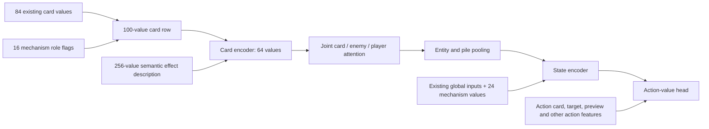

# Feature reference and Battle-agent integration

Contract: **`startup-mechanisms/v1`**. All indices below are zero-based.
The source snapshot uses the v0.111.0 card definitions. See [SOURCE.json](../SOURCE.json).

## Card features: 16 binary roles

For every mechanism the order is `[core, producer, payoff, supply]`.
These groups are multi-label: a card can fill several roles at once.

| Mechanism | Core | Producer | Payoff | Supply | Position in 100-field card row |
| --- | ---: | ---: | ---: | ---: | --- |
| Rupture | 0 | 1 | 2 | 3 | 84–87 |
| Demon Form | 4 | 5 | 6 | 7 | 88–91 |
| Exhaust / Ashen | 8 | 9 | 10 | 11 | 92–95 |
| Hellraiser | 12 | 13 | 14 | 15 | 96–99 |

The four middle columns give positions **within the added 16-value block**.
Each field is named `mechanism:<mechanism>:<role>` in [schema.py](../schema.py).
The internal mechanism names are `rupture`, `demon_form`, `exhaust_ashen`, and
`hellraiser`. All card-role values are raw `float32` 0 or 1.

| Role | Rupture | Demon Form | Exhaust / Ashen | Hellraiser |
| --- | --- | --- | --- | --- |
| `core` | Card named Rupture | Card named DemonForm | Card named AshenStrike | Card named Hellraiser |
| `producer` | Program contains self-targeted `lose_hp` or `damage` | Always 0 in v1; growth is a turn-start power trigger | Can exhaust another card, or self-exhaust through Exhaust/Ethereal/Corruption without Eternal | Program contains an actual `draw` operation |
| `payoff` | Program contains powered damage targeting an enemy, all enemies or a random enemy | Same powered-damage rule | AshenStrike itself | Card has the `Strike` tag |
| `supply` | Can move/clone a visible eligible core, producer or payoff into hand/draw | Same rule for Demon Form | Same rule for Exhaust/Ashen | Can route a visible Strike into draw, or a core/draw producer into hand |

Supply considers `move` and `clone` with destination `hand`, `draw_top`,
`draw_bottom`, or `draw_random`, from visible hand/draw/discard/exhaust piles.
The candidate must match the step's filter (`any`, `attack`, `skill`, `power`,
`attack_or_power`, `rare`, or `strike`). The source card cannot supply itself
from hand; another copy can qualify. Candidate roles use current instance flags
and type. Supply does not recursively propagate through other supply flags.

For Hellraiser, moving a Strike directly into hand is **not a draw event** and
does not, by itself, set supply. Retrieving a draw-producing card or Hellraiser
into hand can set supply. Random generation never certifies a suitable future card.

These are syntactic capability indicators, not predictions that a condition will
be satisfied, an effect will trigger, or a kill will occur. Rupture and Demon Form
payoffs include ordinary single-hit attacks; multi-hit attacks are not a separate
role in v1. Their hit counts remain in the existing semantic representation.
Eternal suppresses self-exhaust capability, but does not remove an explicit
exhaust-other operation. `NoDraw` changes the shared permission flag below,
not the card's draw capability flag.

## Combat state: 24 values

The first 16 fields contain four binary statuses per mechanism.

| Mechanism | `build_enabled` | `online` | `payoff_in_hand` | `payoff_legal_now` |
| --- | ---: | ---: | ---: | ---: |
| Rupture | 0 | 1 | 2 | 3 |
| Demon Form | 4 | 5 | 6 | 7 |
| Exhaust / Ashen | 8 | 9 | 10 | 11 |
| Hellraiser | 12 | 13 | 14 | 15 |

- **`build_enabled`:** an appropriate core is in an observed owned combat pile,
  or the relevant power is active. This does not certify a complete combination.
- **`online`:** Rupture, Demon Form or Hellraiser buff amount is positive.
  Exhaust/Ashen instead requires `build_enabled=1` and **current exhaust pile
  size ≥ 3**. This is a v1 feature heuristic, not a game rule that Ashen Strike
  becomes usable only at three exhausts.
- **`payoff_in_hand`:** at least one payoff card is in the hand.
- **`payoff_legal_now`:** at least one payoff has a legal, admissible play-card
  action now, as supplied by the native adapter.

The last two flags are independent of `online`: a payoff can already be held
and playable before the core power is activated. Played powers can remain active
even though their core card is no longer in a combat pile.

The remaining eight entries are shared across mechanisms:

| Index | Field after `mechanism:` | Raw meaning | Encoding |
| ---: | --- | --- | --- |
| 16 | `strength` | Current total player Strength from every source, including reductions | Signed log1p |
| 17 | `rupture_rate` | Current Rupture buff amount: Strength per qualifying trigger | Signed log1p |
| 18 | `demon_form_rate` | Current Demon Form buff amount: Strength per turn-start trigger | Signed log1p |
| 19 | `exhaust_count` | Number of cards currently in the exhaust pile | Signed log1p |
| 20 | `draw_count` | Number of cards in all visible draw-pile groups combined | Signed log1p |
| 21 | `strike_draw_count` | Strike-tagged cards currently in the draw pile | Signed log1p |
| 22 | `strike_discard_count` | Strike-tagged cards currently in discard | Signed log1p |
| 23 | `effect_draw_allowed_now` | 1 when the NoDraw buff is absent/nonpositive; otherwise 0 | Binary |

For positions **16–22 only**, `encoded(x) = sign(x) × ln(1 + abs(x))`.
For example, `0 → 0`, `1 → 0.693147`, `2 → 1.098612`, `6 → 1.945910`, and
`−2 → −1.098612`. All other added values remain binary. Do not log-transform twice.
The draw-permission flag is the v1 NoDraw check, not a guarantee of available
cards, hand space, or successful future draws.

**Current Strength is not accumulated Strength attributed to one mechanism.**
For example, with Rupture+ rate 2, two qualifying Bloodletting triggers can leave
Strength 4 while the rate remains 2. v1 supplies those two current values; it
does not separately track Rupture's lifetime contribution if other effects also
change Strength. Similarly, retrieving a card from exhaust reduces `exhaust_count`.
The evaluated v1 has no mechanism-specific accumulated-growth or probability fields.

## How the inputs reach the Battle agent

The retained model is **C64-D128-L3, FFN 256**. C64 means a 64-value card embedding;
D128 is the joint attention width; L3 means three joint attention layers.



1. The native adapter supplies observed cards, current instance flags, buffs,
   legal actions and semantic programs. The mechanism features are recomputed
   at each decision during training and inference.
2. Append the 16 roles to the 84-field dense card row. Concatenate that 100-value
   row with its 256-value semantic description; the card encoder produces C64.
3. Joint attention combines cards, enemies and the player. The 24 mechanism
   globals are appended to the existing global vector and enter the **state
   encoder after joint attention/pooling**; they do not create four new tokens.
4. The action head combines encoded state with the action card, target, previews
   and other action features, producing a Q-value per candidate. Existing action
   admissibility handling governs selection. These features do not override it.

The full global position is **`G + i`**, where `G` is the base global-vector
length and `i` is an index in the 24-value block. It is not card position `84 + i`.
Existing enemy HP masks and current-hand lethal features remain on their separate
enemy/action input paths; see [the lethality module](../../current_hand_lethality_v1/README.md).

The model must have the matching expanded input widths. The frozen initialization
keeps the same-seed original submatrices and zeroes the added input columns;
training can then learn their weights. The continuation results load matching
mechanism-aware parents. Appending arrays alone cannot make an old checkpoint
accept or use the new features. This package does not migrate checkpoints.

## Standalone input boundary

[`encoding.py`](../encoding.py) accepts normalized inputs and returns
`MechanismEncoding(card_roles, global_raw, global_encoded)`. It has no hidden
state, RNG, native engine or policy dependency.

```python
from research.startup_mechanisms_v1.encoding import encode, append_features

# cards: complete visible owned cards, with each instance's resolved program/flags.
# buffs: complete visible player buff amounts, e.g. {"Rupture": 1, "Strength": 1}.
# legal_hand_indices: derived from admissible play-card options in the same state.
mechanisms = encode(cards, buffs, legal_hand_indices)
card_dense, global_dense = append_features(base_card_dense, base_global, mechanisms)
```

Each card is a mapping with `name`, `type`, `rarity`, `tags`, `steps`, `flags`,
and `pile`. `flags` explicitly supplies current `exhaust`, `ethereal`, `eternal`;
`type` is the current instance type. `steps` is the already-reviewed, resolved
program from the semantic adapter. Canonical names are lookup metadata for the
four core labels, not card-ID tensors or one-hot card identities.

`pile` is `hand`, `draw`, `discard`, or `exhaust`. Collapse known-top,
known-bottom and unknown draw members into `draw` for these membership/count
features. Keep hand order: legal index 0 means the first hand card in the input,
even if non-hand cards precede it. Native non-pile source snapshots and offered
cards must not be included as owned cards here. The full runtime can encode
roles on those extra nodes separately; this teaching interface omits them.

The program and flags must already reflect upgrades, changed types, enchantments
and spent capabilities. For example, the native role adapter removes only a
spent Swift enchantment's appended draw rule, retaining intrinsic draws. The
small packaged catalog is limited to eleven ordinary unupgraded cards and cannot
resolve those instance changes. This is an encoding demonstration, not a
replacement for the production semantic adapter or a game-rules validator.

`append_features` expects already-encoded `N×84` base cards in the same order
and a one-dimensional base global vector. It returns `float32` `N×100` and
`G+24` arrays without changing inputs. Use it once per observation. Costs,
damage previews, legal actions and simulator transitions must come from the
matching runtime; this module does not calculate them.
